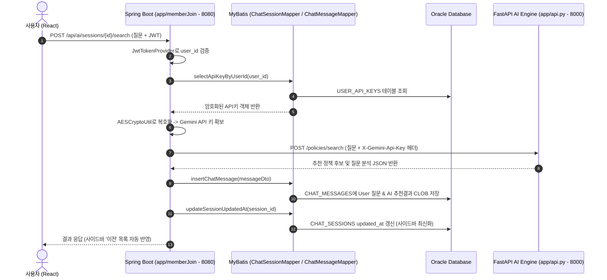

# WelfareOne 인증, API키 관리 및 사이드바 히스토리 연동 구현 계획

본 문서는 **Java 17** 기반의 **Spring Boot 3.2.4**와 **Oracle DB**를 도입하여 **회원가입, 로그인(JWT), Gemini API 키 암호화 저장, 좌측 사이드바(aside) 동적 히스토리 및 사용자 프로필 연동**, 그리고 기존 **FastAPI(Python AI 파이프라인)**와의 연동을 구현하기 위한 종합 설계 및 단계별 실행 계획입니다.

> **참조 문서 (Context)**: [`docs/function_contracts.md`](file:///c:/work/WelfareOne/docs/function_contracts.md)의 공통 데이터 명명 규칙(snake_case, `policy_id`, `route`, `intents` 등)과 API 응답 규격을 준수합니다.

---

## 1. 시스템 통합 아키텍처 (BFF 패턴)

Spring Boot를 **BFF(Backend For Frontend)**이자 메인 비즈니스 서버로 배치하여, 보안과 데이터 영속성을 책임지고 Python FastAPI는 AI/RAG 전용 서브엔진으로 활용합니다.

```mermaid
flowchart LR
    subgraph Client ["프론트엔드 (React SPA)"]
        UI_Sidebar["좌측 사이드바 (aside)\n- 비로그인: WelfareOne + LocalStorage\n- 로그인: 사용자 이름 + Oracle DB 히스토리"]
        UI_Chat["메인 채팅창 (ChatPage)"]
        UI_Key["API 키 관리 다이얼로그"]
        UI_AuthModal["공통 로그인/가입 포털\n(공공데이터포털 2단 스타일)"]
    end

    subgraph SpringBoot ["Spring Boot (Java 17 / Spring Boot 3.2.4 / Port 8080)"]
        Security["Spring Security + JWT"]
        UserSvc["회원 & 프로필 관리"]
        KeySvc["API 키 암호화/복호화 (AES-256)"]
        HistSvc["히스토리 세션/메시지 관리"]
        AIProxy["FastAPI 중계 클라이언트\n(RestClient / WebClient)"]
    end

    subgraph Oracle ["Oracle Database"]
        TB_USER[("USERS")]
        TB_KEY[("USER_API_KEYS")]
        TB_SESS[("CHAT_SESSIONS")]
        TB_MSG[("CHAT_MESSAGES")]
    end

    subgraph FastAPI ["FastAPI (Python / Port 8000)"]
        RAG_Search["/policies/search"]
        RAG_Ask["/policies/{id}/ask"]
        Chroma[("ChromaDB\n(벡터 검색)")]
        Gemini["Google Gemini API"]
    end

    Client -->|1. 로그인/회원가입/토큰| Security
    Client -->|2. 사이드바 히스토리 목록 및 세션 로드| HistSvc
    Client -->|3. AI 질문 요청 (JWT)| AIProxy

    Security --> UserSvc
    UserSvc --> TB_USER
    KeySvc --> TB_KEY
    HistSvc --> TB_SESS
    HistSvc --> TB_MSG

    AIProxy -->|API 키 복호화 조회| KeySvc
    AIProxy -->|HTTP POST + X-Gemini-Api-Key 헤더| FastAPI
    AIProxy -->|상담 세션 & 질의응답 자동 저장| HistSvc

    FastAPI --> Chroma
    FastAPI --> Gemini
```

### 아키텍처 핵심 이점
1. **친숙한 좌측 사이드바(aside) UX 유지 및 고도화**:
   - 별도 화면으로 히스토리를 분리하지 않고, 사용자가 익숙한 **좌측 사이드바(`aside.sidebar`)의 대화 목록(`이전` 섹션)**에서 즉시 상담 기록을 열람·전환할 수 있습니다.
2. **세션 상태에 따른 지능형 UI 전환**:
   - **비로그인 상태**: 서비스명(`WelfareOne`) 표시, 브라우저 LocalStorage 기반 임시 기록 표시, 로그인/가입 진입 버튼 제공.
   - **로그인 상태**: `WelfareOne` 위치에 **사용자 이름/닉네임** 표시, **Oracle DB 클라우드 대화 기록**이 실시간 동기화되어 영구 보존.
3. **API 키 완벽 은닉 (보안 극대화)**:
   - 사용자의 Gemini API 키는 Spring Boot에서 **AES-256**으로 암호화되어 Oracle DB에만 저장되며 프론트엔드로 재노출되지 않습니다.

---

## 2. 좌측 사이드바(aside) 동적 UI 설계 (핵심)

기존 `ChatPage.tsx`의 `<aside className="sidebar">` 구조를 바탕으로, 세션 로그인 여부에 따라 완전히 다른 모드로 동작하도록 설계합니다.

### 2.1. 사이드바 모드별 와이어프레임 비교

```text
[ 비로그인 게스트 모드 ]                    [ 로그인 세션 활성화 모드 ]
┌───────────────────────────────┐          ┌───────────────────────────────┐
│ WelfareOne                    │          │ 홍길동 님  [로그아웃]          │  <-- 서비스명 대신 사용자 이름
├───────────────────────────────┤          ├───────────────────────────────┤
│ [ + 새 상담 ]                 │          │ [ + 새 상담 ]                 │
├───────────────────────────────┤          ├───────────────────────────────┤
│ 이전                          │          │ 이전                          │
│  · 월세가 부담돼요             │          │  · 관악구 월세 지원 상담       │  <-- Oracle DB 저장 세션 목록
│    부산광역시 · 33세          │          │    서울특별시 관악구 · 25세    │     (기기가 바뀌어도 유지)
│  · 대중교통비를 지원해 주...   │          │  · 청년 취업 준비금 문의       │
│    부산광역시 · 33세          │          │    서울특별시 관악구 · 25세    │
├───────────────────────────────┤          ├───────────────────────────────┤
│ 상담 기록은 이 브라우저에만   │          │ 상담 기록이 클라우드(DB)에    │
│ 저장돼요. 공용 PC에서는 사용  │          │ 안전하게 보관 중입니다.       │
│ 후 삭제해 주세요.             │          │                               │
│ [기록 모두 삭제]              │          │ [API 키 설정]                 │
│                               │          │                               │
│ [로그인 / 회원가입 버튼]      │          │                               │
├───────────────────────────────┤          ├───────────────────────────────┤
│ [시스템] [라이트] [다크]      │          │ [시스템] [라이트] [다크]      │
└───────────────────────────────┘          └───────────────────────────────┘
```

### 2.2. 상태별 상세 동작 명세

#### A. 비로그인 상태 (게스트 모드)
- **상단 브랜드**: 기존과 동일하게 `WelfareOne` 로고/서비스명 텍스트 노출.
- **`+ 새 상담` 버튼**: 클릭 시 비회원 시작 폼(지역/나이 재설정) 또는 빈 상담창 시작.
- **`이전` 섹션 (대화 기록)**:
  - 브라우저 `localStorage`에서 읽어온 임시 대화 목록(`ConversationList`)을 날짜별(오늘, 어제, 최근 7일, 이전)로 표시.
- **하단 영역**:
  - 안내 문구: `"상담 기록은 이 브라우저에만 저장돼요. 공용 PC에서는 사용 후 삭제해 주세요."`
  - 액션: `[기록 모두 삭제]` 링크 버튼.
  - **로그인 진입 버튼**: `[로그인 / 회원가입]` 버튼이 돋보이게 배치되어, 클릭 시 공공데이터포털 스타일의 로그인/가입 포털로 즉시 진입 가능.

#### B. 로그인 세션 활성화 상태 (회원 모드)
- **상단 브랜드 영역의 전환**:
  - 기존 `WelfareOne` 자리에 **사용자 이름/닉네임 (예: `홍길동 님`)**이 표시됨.
  - 우측에 작은 `[로그아웃]` 아이콘/텍스트 버튼 제공.
- **`+ 새 상담` 버튼**:
  - 클릭 시 회원의 기본 거주지(시도/시군구)와 나이가 자동 세팅된 상태로 Oracle DB에 새 세션을 생성하고 즉시 상담 시작.
- **`이전` 섹션 (저장된 대화기록)**:
  - **Oracle DB (`CHAT_SESSIONS` 테이블)**에서 조회한 상담 세션 목록이 날짜별로 그룹화되어 표시.
  - 세션 항목 클릭 시: Spring Boot API (`GET /sessions/{session_id}`)를 호출하여 Oracle DB에 영구 저장된 과거 사용자 질문, AI 답변, 추천 정책 카드, 인용 근거 전체를 메인 채팅창에 복원.
  - 세션별 `✕` 삭제 버튼 클릭 시: Oracle DB에서 해당 세션 및 메시지 삭제.
- **하단 영역**:
  - 안내 문구: `"상담 기록이 클라우드(Oracle DB)에 안전하게 보관 중입니다."`
  - `[API 키 관리]` 버튼: 서버에 암호화 보관된 Gemini API 키 상태 확인 및 갱신 다이얼로그 호출.

---

## 3. 공공데이터포털 스타일 2단 로그인/회원가입 포털 UI

비로그인 상태에서 사이드바의 `[로그인 / 회원가입]` 버튼을 누르거나 서비스 최초 진입 시 제공되는 화면입니다.  
공공데이터포털([auth.data.go.kr/sso/common-login](https://auth.data.go.kr/sso/common-login))의 2열 Split-Grid 디자인을 따릅니다.

```text
┌────────────────────────────────────────────────────────────────────────┐
│  [KRDS 상단 안내] 대한민국 청년 맞춤형 복지정책 검색 시스템                   │
├────────────────────────────────────────────────────────────────────────┤
│                           WelfareOne                                   │
│            청년 복지정책 AI 맞춤 안내 서비스에 오신 것을 환영합니다               │
│                                                                        │
│ ┌──────────────────────────────────┬─────────────────────────────────┐ │
│ │  [왼쪽: 회원 서비스 영역]        │  [오른쪽: 비회원 바로 시작 영역] │ │
│ │                                  │                                 │ │
│ │  [ 탭: 로그인  |  회원가입 ]     │  비회원으로 바로 상담 시작하기     │ │
│ │                                  │                                 │ │
│ │  (로그인 모드 선택 시)           │  거주 지역 선택                 │ │
│ │  - 이메일 (아이디)               │  [ 시·도 선택  ▼ ]             │ │
│ │  - 비밀번호 (보기 아이콘)        │  [ 시·군·구 선택 ▼ ]             │ │
│ │  [v] 아이디 저장                 │                                 │ │
│ │  [   로그인 버튼 (Primary)   ]   │  만 나이 입력                   │ │
│ │  - 비밀번호 찾기 | 회원가입      │  [ 만 24 세 ]                   │ │
│ │                                  │                                 │ │
│ │  (회원가입 모드 선택 시)         │  [  비회원 상담 시작하기 버튼  ]│ │
│ │  - 이메일 / 비밀번호 / 확인      │                                 │ │
│ │  - 닉네임 / 기본 지역 / 나이     │  ※ 비회원 이용 시 대화 내역은   │ │
│ │  [    가입하기 버튼 (Primary)  ] │     현재 브라우저에만 임시      │ │
│ │                                  │     저장되며, 기기 간 공유 및   │ │
│ │  ★ 회원 혜택:                   │     API키 저장은 제공되지       │ │
│ │   · Gemini API 키 안전 자동 보관 │     않습니다.                   │ │
│ │   · 모든 기기에서 상담 기록 보존 │                                 │ │
│ └──────────────────────────────────┴─────────────────────────────────┘ │
└────────────────────────────────────────────────────────────────────────┘
```

- **로그인 성공 시**:
  - 발급받은 JWT 토큰을 저장하고 메인 채팅 페이지로 즉시 이동.
  - 왼쪽 aside 상단이 `WelfareOne`에서 **회원 이름**으로 전환되고, `이전` 섹션에 Oracle DB 대화 목록이 로드됨.
- **오른쪽 비회원 바로 시작 시**:
  - 기존 비회원 상담 세션으로 진입하며, 왼쪽 aside 상단은 `WelfareOne`이 유지되고 대화 내역은 LocalStorage에 기록됨.

---

## 4. Oracle DB 스키마 설계 (DDL 명세)

상세 DDL 전문은 [`docs/oracle_schema.sql`](file:///c:/work/WelfareOne/docs/oracle_schema.sql)에 작성되어 있습니다.

```sql
-- 1. 회원 테이블 (USERS)
CREATE TABLE USERS (
    user_id                 NUMBER GENERATED ALWAYS AS IDENTITY PRIMARY KEY,
    email                   VARCHAR2(100 CHAR) NOT NULL UNIQUE,
    password_hash           VARCHAR2(255)      NOT NULL,
    nickname                VARCHAR2(50 CHAR)  NOT NULL,
    default_region_level1   VARCHAR2(50 CHAR),
    default_region_level2   VARCHAR2(50 CHAR),
    default_age             NUMBER(3),
    created_at              TIMESTAMP          DEFAULT CURRENT_TIMESTAMP NOT NULL,
    updated_at              TIMESTAMP          DEFAULT CURRENT_TIMESTAMP NOT NULL
);

-- 2. 사용자 Gemini API 키 테이블 (USER_API_KEYS)
CREATE TABLE USER_API_KEYS (
    key_id                  NUMBER GENERATED ALWAYS AS IDENTITY PRIMARY KEY,
    user_id                 NUMBER             NOT NULL UNIQUE,
    encrypted_key           VARCHAR2(512)      NOT NULL,
    iv_salt                 VARCHAR2(64)       NOT NULL,
    is_active               CHAR(1)            DEFAULT 'Y' CHECK (is_active IN ('Y', 'N')),
    created_at              TIMESTAMP          DEFAULT CURRENT_TIMESTAMP NOT NULL,
    updated_at              TIMESTAMP          DEFAULT CURRENT_TIMESTAMP NOT NULL,
    CONSTRAINT fk_keys_user FOREIGN KEY (user_id) REFERENCES USERS(user_id) ON DELETE CASCADE
);

-- 3. 상담 세션 마스터 (CHAT_SESSIONS - aside의 '이전' 대화 목록)
CREATE TABLE CHAT_SESSIONS (
    session_id              VARCHAR2(36)       PRIMARY KEY,
    user_id                 NUMBER             NOT NULL,
    title                   VARCHAR2(200 CHAR) NOT NULL,
    region_level1           VARCHAR2(50 CHAR)  NOT NULL,
    region_level2           VARCHAR2(50 CHAR),
    age                     NUMBER(3),
    created_at              TIMESTAMP          DEFAULT CURRENT_TIMESTAMP NOT NULL,
    updated_at              TIMESTAMP          DEFAULT CURRENT_TIMESTAMP NOT NULL,
    CONSTRAINT fk_sessions_user FOREIGN KEY (user_id) REFERENCES USERS(user_id) ON DELETE CASCADE
);

-- 4. 대화 세부 메시지 (CHAT_MESSAGES - 질문, AI답변, 추천정책, 인용근거)
CREATE TABLE CHAT_MESSAGES (
    message_id              VARCHAR2(36)       PRIMARY KEY,
    session_id              VARCHAR2(36)       NOT NULL,
    sender_type             VARCHAR2(20)       NOT NULL CHECK (sender_type IN ('USER', 'ASSISTANT')),
    content                 CLOB               NOT NULL,
    route                   VARCHAR2(50),
    intents_json            VARCHAR2(200),
    selected_policy_id      VARCHAR2(50),
    candidates_json         CLOB,
    evidence_json           CLOB,
    resources_json          CLOB,
    created_at              TIMESTAMP          DEFAULT CURRENT_TIMESTAMP NOT NULL,
    CONSTRAINT fk_messages_session FOREIGN KEY (session_id) REFERENCES CHAT_SESSIONS(session_id) ON DELETE CASCADE
);

-- 조회 성능 인덱스
CREATE INDEX idx_sessions_user_updated ON CHAT_SESSIONS(user_id, updated_at DESC);
CREATE INDEX idx_messages_session_created ON CHAT_MESSAGES(session_id, created_at ASC);
```

---

## 5. Spring Boot REST API 명세

[`docs/function_contracts.md`](file:///c:/work/WelfareOne/docs/function_contracts.md) 17장과 동일한 규격을 사용합니다:

- **인증 API**:
  - `POST /api/auth/signup`: 회원가입
  - `POST /api/auth/login`: 로그인 및 JWT 토큰 반환
  - `GET /api/auth/me`: 현재 로그인 회원 정보 및 닉네임 반환
  - `POST /api/auth/logout`: 로그아웃
- **API 키 관리 API**:
  - `PUT /api/users/api-key`: Gemini API 키 등록/수정 (AES-256 암호화)
  - `GET /api/users/api-key/status`: 등록 여부 확인
- **히스토리 사이드바 API (`/api/history`)**:
  - `GET /api/history/sessions`: aside의 `이전` 목록에 바인딩할 상담 세션 목록 (최신순)
  - `POST /api/history/sessions`: 새 상담 시작 시 세션 생성
  - `GET /api/history/sessions/{session_id}`: 클릭 시 과거 대화 내용 및 추천 카드 복원
  - `DELETE /api/history/sessions/{session_id}`: 상담 세션 삭제
- **AI 서비스 프록시 (`/api/ai` -> FastAPI 8000번 호출)**:
  - `POST /api/ai/sessions/{session_id}/search`: 정책 추천 검색 (FastAPI 중계 + Oracle DB 자동 저장)
  - `POST /api/ai/sessions/{session_id}/policies/{policy_id}/ask`: 정책 세부 질문 (FastAPI 중계 + Oracle DB 자동 저장)

---

## 6. 프론트엔드 상태 머신 및 사이드바 연동 흐름

```mermaid
stateDiagram-v2
    [*] --> CheckSession: 앱 시작

    state CheckSession {
        [*] --> ValidateToken
        ValidateToken --> GuestMode: 토큰 없음 (비로그인)
        ValidateToken --> MemberMode: 토큰 유효 (로그인 성공)
    }

    state GuestMode {
        note right of GuestMode
            - aside 상단: [WelfareOne]
            - aside 이전 목록: LocalStorage 임시 기록
            - aside 하단: [로그인/가입 버튼] 노출
        end note
        [*] --> GuestChat
    }

    state MemberMode {
        note right of MemberMode
            - aside 상단: [홍길동 님] + [로그아웃]
            - aside 이전 목록: Oracle DB 세션 목록
            - aside 하단: 클라우드 보관 안내
        end note
        [*] --> MemberChat
    }

    GuestMode --> MemberMode: 로그인 완료 시
    MemberMode --> GuestMode: 로그아웃 클릭 시
```

---

## 7. 단계별 상세 구현 로드맵

### Phase 1: Spring Boot 프로젝트 및 Oracle DB 연동 세팅 (MyBatis)
- [ ] Spring Boot 3.2.4 (Java 17) 프로젝트 세팅 (Spring Web, Security, MyBatis `3.0.3`, Oracle Driver `ojdbc11`, Lombok, JJWT)
- [ ] `application.yml`에 Oracle DB 연결 정보 및 MyBatis 매퍼 경로 설정
- [ ] Oracle DDL([`docs/oracle_schema.sql`](file:///c:/work/WelfareOne/docs/oracle_schema.sql)) 실행 및 테이블 생성
- [ ] 도메인 모델(`domain/`) 및 MyBatis 매퍼 인터페이스/XML 작성

### Phase 2: 회원가입, 로그인 & 보안 체계 구축
- [ ] `BCryptPasswordEncoder` 및 Spring Security 필터 체인 구성
- [ ] `JwtTokenProvider` 및 `JwtAuthenticationFilter` 구현
- [ ] 회원가입 (`/api/auth/signup`) 및 로그인 (`/api/auth/login`) API 구현 (UserMapper 연동)

### Phase 3: Gemini API 키 암호화 관리 (AES-256)
- [ ] `AESCryptoUtil` 구현: 서버 환경변수 마스터 키를 이용한 AES-256-GCM 암호화/복호화
- [ ] API 키 등록/수정/삭제 엔드포인트 (`/api/users/api-key`) 구현 (UserApiKeyMapper 연동)

### Phase 4: FastAPI 통신 및 AI 중계 서비스
- [ ] Spring `RestClient` 기반 `FastApiClient` 구현
- [ ] 사용자 요청 시 DB에서 API 키 복호화 후 `X-Gemini-Api-Key` 헤더에 주입하여 FastAPI 호출
- [ ] 질문 및 AI 응답 데이터를 트랜잭션 내에서 Oracle DB(`ChatMessageMapper`)에 자동 영속화

### Phase 5: 좌측 Aside 사이드바 동적 전환 (`ChatPage.tsx`)
- [ ] `aside.sidebar` 상단 브랜드 영역 조건부 렌더링:
  - 비로그인: `WelfareOne`
  - 로그인: `홍길동 님` + `[로그아웃]` 버튼
- [ ] `ConversationList.tsx`의 데이터 소스 스위칭:
  - 비로그인: `localStorage`
  - 로그인: Spring Boot API (`GET /api/history/sessions`)
- [ ] 사이드바 하단 `[로그인 / 회원가입]` 진입 버튼 배치

### Phase 6: 공공데이터포털 스타일 2단 로그인/가입 포털 연동
- [ ] `CommonLoginPortal.tsx` 모달/페이지 개발 (좌측 회원가입/로그인 탭, 우측 비회원 폼)
- [ ] 로그인 완료 시 즉시 사이드바가 사용자 이름으로 전환되고 DB 대화기록 로드

---

## 8. 테스트 및 검증 체크리스트

| 검증 항목 | 기대 결과 |
|---|---|
| **비로그인 aside** | 상단에 `WelfareOne` 표시, LocalStorage 임시 대화 기록 노출, `[로그인/가입]` 버튼 노출 |
| **로그인 aside** | 상단에 `WelfareOne` 대신 **사용자 이름(`홍길동 님`)** 표시, Oracle DB 대화 기록 노출 |
| **대화기록 복원** | 로그인 상태에서 `이전` 항목 클릭 시 Oracle DB에서 과거 질문/답변/추천카드가 메인 채팅창에 온전히 복원 |
| **로그아웃 동작** | `[로그아웃]` 클릭 시 즉시 비로그인 aside(`WelfareOne`)로 전환되고 토큰 제거 |
| **API 키 암호화** | Oracle DB에 평문이 아닌 암호문으로 저장, FastAPI 호출 시 정상 복호화 전송 |

---

## 9. Spring Boot 백엔드 (`app/memberJoin/`) 모듈 및 파일 구조 계획

회원가입, 로그인(JWT), Gemini API 키 암호화 보관, 대화 히스토리 영속화는 **Java 17** 기반의 **Spring Boot 3.2.4 (Gradle)**와 **MyBatis 3.0.3** SQL 매퍼를 사용하여 **`app/memberJoin/`** 폴더에 구축됩니다.

### 9.1. `app/memberJoin/` 프로젝트 디렉토리 및 패키지 구조

```text
app/memberJoin/
├── build.gradle                              # Gradle 빌드 스크립트 (Spring Boot 3.2.4, Java 17, MyBatis, Oracle, JJWT)
├── settings.gradle                           # 프로젝트명 (memberJoin)
└── src/
    ├── main/
    │   ├── java/com/welfareone/memberjoin/
    │   │   ├── MemberJoinApplication.java    # Spring Boot 메인 실행 클래스
    │   │   │
    │   │   ├── config/                       # 설정 클래스 패키지
    │   │   │   ├── SecurityConfig.java       # Spring Security 필터 체인, CORS, BCrypt 빈 설정
    │   │   │   └── WebClientConfig.java      # FastAPI(8000) 통신용 RestClient 빈 설정
    │   │   │
    │   │   ├── controller/                   # REST API 컨트롤러 패키지
    │   │   │   ├── AuthController.java       # /api/auth/signup, /api/auth/login, /api/auth/me
    │   │   │   ├── ApiKeyController.java     # /api/users/api-key (등록, 상태조회, 삭제)
    │   │   │   ├── HistoryController.java    # /api/history/sessions (aside 대화기록 CRUD)
    │   │   │   └── AiProxyController.java    # /api/ai/sessions/... (FastAPI 중계 + DB 자동 저장)
    │   │   │
    │   │   ├── dto/                          # 입출력 데이터 전송 객체 (Request / Response)
    │   │   │   ├── SignUpRequest.java        # 회원가입 요청 DTO (이메일, 비밀번호, 닉네임, 지역/나이)
    │   │   │   ├── LoginRequest.java         # 로그인 요청 DTO (이메일, 비밀번호)
    │   │   │   ├── AuthResponse.java         # JWT 토큰 및 회원 프로필 응답 DTO
    │   │   │   ├── ApiKeyRequest.java        # Gemini API 키 등록 DTO
    │   │   │   └── SessionSummaryDto.java    # aside '이전' 목록용 세션 요약 DTO
    │   │   │
    │   │   ├── domain/                       # 도메인 모델 VO / DTO 패키지
    │   │   │   ├── User.java                 # USERS 테이블 매핑 객체
    │   │   │   ├── UserApiKey.java           # USER_API_KEYS 테이블 매핑 객체
    │   │   │   ├── ChatSession.java          # CHAT_SESSIONS 테이블 매핑 객체
    │   │   │   └── ChatMessage.java          # CHAT_MESSAGES 테이블 매핑 객체
    │   │   │
    │   │   ├── mapper/                       # MyBatis 매퍼 인터페이스 (@Mapper)
    │   │   │   ├── UserMapper.java           # 회원 조회, 등록, 중복 체크
    │   │   │   ├── UserApiKeyMapper.java     # API 키 조회, 등록/수정, 삭제
    │   │   │   ├── ChatSessionMapper.java    # 세션 목록 조회, 세션 생성/삭제/수정
    │   │   │   └── ChatMessageMapper.java    # 대화 메시지 로그 등록, 세션별 메시지 복원
    │   │   │
    │   │   ├── service/                      # 핵심 비즈니스 로직 서비스 패키지
    │   │   │   ├── AuthService.java          # 회원가입, 로그인 검증, 중복체크, JWT 발급
    │   │   │   ├── ApiKeyService.java        # API 키 AES-256 양방향 암호화 저장 및 복호화
    │   │   │   ├── HistoryService.java       # 사이드바 세션 생성, 조회, 대화 메시지 영속화
    │   │   │   └── FastApiClientService.java # FastAPI(포트 8000) HTTP 통신 중계
    │   │   │
    │   │   └── util/                         # 유틸리티 패키지
    │   │       ├── JwtTokenProvider.java     # JJWT 토큰 생성, 서명 검증, 클레임 추출
    │   │       └── AESCryptoUtil.java        # AES-256-GCM 알고리즘 암호화/복호화 유틸
    │   │
    │   └── resources/
    │       ├── application.yml               # Oracle DB 접속 URL, 계정, MyBatis 설정, JWT Secret
    │       └── mapper/                       # MyBatis XML 매퍼 SQL 파일
    │           ├── UserMapper.xml            # 회원 관련 SQL (INSERT, SELECT)
    │           ├── UserApiKeyMapper.xml      # API 키 관련 SQL (MERGE INTO, SELECT, DELETE)
    │           ├── ChatSessionMapper.xml     # 세션 목록 최신순 정렬 쿼리 (SELECT, INSERT, DELETE)
    │           └── ChatMessageMapper.xml     # 대화 로그 쿼리 (INSERT, SELECT ORDER BY CREATED_AT)
    │
    └── test/                                 # 단위/통합 테스트
```

### 9.2. 신규 패키지별 상세 역할 및 책임

| 패키지 | 주요 파일 | 세부 역할 및 책임 |
|---|---|---|
| **`controller`** | `AuthController`<br>`ApiKeyController`<br>`HistoryController`<br>`AiProxyController` | - 프론트엔드 React와 JSON 기반 REST API 통신<br>- JWT 인증 필터를 통과한 사용자 식별(`@AuthenticationPrincipal`)<br>- HTTP 요청 유효성 검사(`@Valid`) 및 표준 에러 응답 반환 |
| **`service`** | `AuthService`<br>`ApiKeyService`<br>`HistoryService`<br>`FastApiClientService` | - 회원가입 시 비밀번호 BCrypt 해싱 및 `UserMapper` 호출<br>- 로그인 성공 시 JWT 발급<br>- Gemini API 키의 **AES-256** 암호화 및 복호화 처리<br>- aside `이전` 대화 목록 조회 및 세션 클릭 시 메시지 복원<br>- AI 응답 데이터를 트랜잭션(`@Transactional`) 내에서 Oracle DB에 영속화 |
| **`domain`** | `User`<br>`UserApiKey`<br>`ChatSession`<br>`ChatMessage` | - Oracle DB DDL([`docs/oracle_schema.sql`](file:///c:/work/WelfareOne/docs/oracle_schema.sql)) 테이블과 1:1 대응하는 순수 Java 객체 (POJO)<br>- `mapUnderscoreToCamelCase: true` 설정으로 DB 컬럼명과 자동 매핑 |
| **`mapper`** | `UserMapper`<br>`ChatSessionMapper` 등 | - MyBatis `@Mapper` 애너테이션이 붙은 Java 인터페이스<br>- `src/main/resources/mapper/*.xml`의 SQL 태그 ID와 메서드명 1:1 바인딩 |
| **`resources/mapper`** | `*.xml` 파일들 | - Oracle 특화 쿼리 작성 (CLOB 처리, `ORDER BY updated_at DESC`, `MERGE INTO` 등)<br>- 대용량 JSON 데이터(추천 정책, 근거 구절)를 `CLOB` 타입으로 안전하게 INSERT/SELECT |
| **`util`** | `JwtTokenProvider`<br>`AESCryptoUtil` | - `io.jsonwebtoken` 라이브러리를 사용한 무상태(Stateless) 토큰 처리<br>- 32바이트 서버 환경변수 키를 사용한 안전한 AES-256-GCM 양방향 암호화 |

### 9.3. 처리 흐름 예시 (로그인 회원의 질문 및 자동 히스토리 저장)




